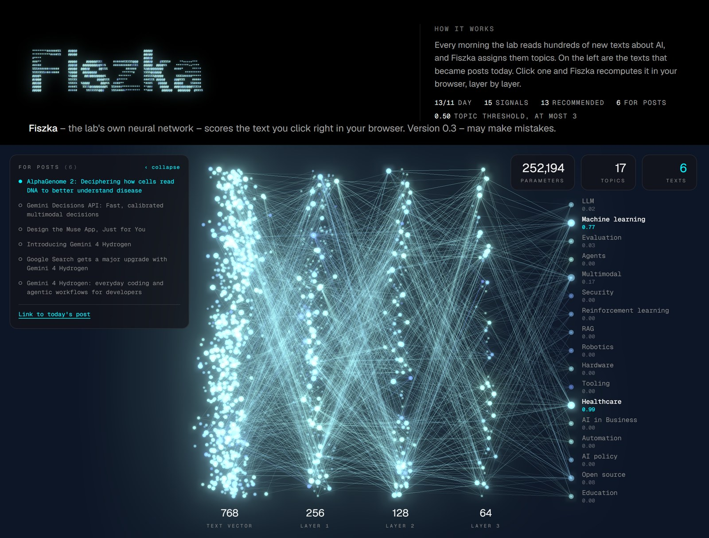

# Fiszka 0.3: a small network that recognizes AI topics

Fiszka reads an AI paper abstract or a news article and returns its main topics, from zero to three
out of 17 (language models, agents, security, robotics, business, policy and more).
It is a 252,194-weight network on top of EmbeddingGemma 2 embeddings. The network itself needs a few
microseconds per text on a CPU; computing the embedding is the slow part.



Built by [Creative AI Driven PM](https://creativeaidrivenpm.com/) in [aipoc-lab](https://aipoclab.creativeaidrivenpm.com/),
a one-person AI lab. I learn, build and test what actually works.
Since 7 November 2026 Fiszka has tagged every new text in the lab's pipeline.
Live demo: [aipoclab.creativeaidrivenpm.com/en/fiszka](https://aipoclab.creativeaidrivenpm.com/en/fiszka)
(click a text and the network recomputes it in your browser).

## Quick start

```bash
ollama pull embeddinggemma-2:270m
pip install numpy
python fiszka.py --title "ReAct agents for web browsing" --text "We present an agent that plans multi-step actions ..."
```

Output is one JSON line per text: the chosen topics plus the probability for each of the 17 topics.
For many texts, send JSON lines `{"title": ..., "text": ...}` on stdin.
Already have 768-d EmbeddingGemma 2 vectors? Use `--vectors file.npy`. Ollama is then not needed.

`fiszka.py` needs only numpy and the Python standard library. `model.safetensors` also loads with the
`safetensors` library; the layers are stored like `torch.nn.Linear` (`out_features × in_features`).

## Topics

| key | topic | key | topic |
|---|---|---|---|
| `llm` | Language models | `hardware` | Hardware |
| `ml` | Machine learning | `tooling` | Tooling |
| `evaluation` | Evaluation | `healthcare` | Healthcare |
| `agents` | Agents | `business` | Business |
| `multimodal` | Multimodal | `automation` | Automation |
| `security` | Security | `policy` | Policy & regulation |
| `reinforcement-learning` | Reinforcement learning | `open-source` | Open source |
| `rag` | RAG & retrieval | `education` | Education |
| `robotics` | Robotics | | |

A topic counts only when it is the main subject of the text, not a tool used along the way.
A paper that uses ChatGPT to grade essays is `education`, not `llm`.

## How it works

1. Text preparation: the arXiv announcement header and HTML are stripped, then the input becomes
   `title: {title} | text: {first 4,000 characters}`. Texts under 200 characters get no topics.
2. EmbeddingGemma 2 (`embeddinggemma-2:270m` in Ollama) turns the text into 768 numbers.
3. The network: 768 → 256 → 128 → 64 → 17 with ReLU, plus a direct linear path 768 → 17
   (a logistic regression inside, which the hidden layers correct). Sigmoid per topic.
4. Decision: topics with probability ≥ 0.5, at most the three most confident.

## Training data and labels

- 9,968 texts the lab collected between August and October 2026: mostly arXiv cs.AI abstracts,
  plus AI company blogs and news. The texts themselves are not published.
- Labels come from two open-weight language models acting as teachers: DeepSeek V4.1 Flash 1017 (MIT)
  and NVIDIA Nemotron 3.5 Lightning (OpenMDW 1.1). A topic is a label only when **both** gave it.
  No labels from closed models were used.
- Class weights for rare topics; early stopping and the threshold were chosen on the newest 20% of the data (1,994 texts).

## Evaluation

Measured against topics assigned by hand by one person (the lab's author), on texts the model never saw.
F1 is the balance between "found the right topics" (recall) and "did not add wrong ones" (precision).

| Test set | Texts | Precision | Recall | F1 |
|---|---:|---:|---:|---:|
| Hand-labelled set 1 | 75 | 0.458 | 0.575 | **0.510** |
| Hand-labelled set 2 (newer texts, labelled later) | 83 | 0.538 | 0.571 | **0.554** |
| arXiv papers vs the authors' own arXiv categories | 2,522 | – | 0.803 | – |

For scale, on set 2 the teachers' own labels scored F1 0.508 (both teachers) and 0.559 (DeepSeek alone).
Fiszka matches the labels it learned from: the limit is the quality of the labels, not the size of the network.

### Compared with Gemini (take it with a grain of salt)

Before Fiszka, the lab tagged texts with Gemini 3.5 Flash Lite. On set 1 those tags scored F1 0.342
(precision 0.295, recall 0.407), Fiszka 0.510. This is our internal test of our own setup, not a verdict on Gemini:
the Gemini tags came from our prompt and from an older list of 13 topics without `business` and `policy`,
so part of the gap comes from topics Gemini was never asked about. In our use case Fiszka came out better,
and that is all this number says. Gemini tags were used only for this comparison, never for training.

## Version 0.4 did not win

Before release I tried a 0.4: the same network that also reads 5,000 words directly (337,211 weights).
It scored 0.486 vs 0.510 on set 1 and 0.580 vs 0.554 on set 2. Overall a tie, so 0.3 stays.
Fine-tuning on the 160 hand labels gave +0.010 F1, within chance. The full protocol, including
failed attempts, is kept in the lab.

## Limitations

- One person labelled the test sets; their own consistency is low on `llm`, `evaluation`, `agents` and `open-source`.
- The test sets are small (75 and 83 texts), so differences below about 0.03 F1 are noise.
- `llm` is under-detected: the second teacher rarely gave it, so the shared labels rarely contain it.
- Trained on English texts about AI. Other languages and other domains are untested.
- The vectors must come from `embeddinggemma-2:270m` with exactly the input format above; another embedding model will give meaningless results.
- Meant for tagging and browsing content, not for decisions about people.

## Weights on Instagram

The whole model also fits in six Instagram images. The decoder that reads the weights back from a
phone screenshot: [fiszka-dekoder-instagram](https://github.com/ch3sh1r3xx11/fiszka-dekoder-instagram).

## License

Apache 2.0. EmbeddingGemma 2 is a separate model with its own license and is not included here.
